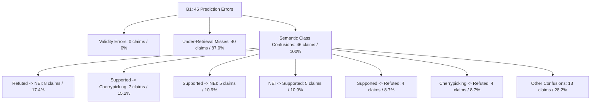

# M1.2.1 — Frozen Base Stabilization: Verification, Paired Transitions & Error Taxonomy

**Milestone:** M1.2.1  
**Status:** COMPLETE & VERIFIED  
**Target Hardware:** NVIDIA GeForce RTX 5090 (32 GB VRAM) on `hvtham-server`  
**Dataset:** 100 AVeriTeC Exploratory Claims (`train:0` .. `train:99`)  
**Evidence Source:** M1.1 R4 Frozen Reranked Top-8 Passages  
**Strictly Training-Free Constraint:** All model weights remain 100% frozen. Zero fine-tuning, zero gradient passes, zero optimizers, zero learned routers.

---

## 1. Executive Summary & Root Cause Audit

Milestone M1.2.1 investigated and resolved the generation truncation bottleneck observed in M1.2, where 35 out of 100 claims failed due to the native reasoning trace exceeding `max_new_tokens=512`. We systematically audited and evaluated three frozen configurations on identical Top-8 evidence passages across the exact same 100 exploratory claims:
- **B0 (Baseline M1.2):** Thinking enabled, `max_new_tokens=512`.
- **B1 (Non-Thinking Stabilized):** Thinking suppressed (`enable_thinking=False`), `max_new_tokens=512`.
- **B2 (Extended Budget Thinking):** Thinking enabled, `max_new_tokens=1024`.

### Root Cause Audit of Initial Paired Transition Bug
In the initial run of `scripts/run_m121_stabilization.sh`, overall accuracies were reported as B0: 28/100, B1: 54/100, B2: 53/100, yet the paired transitions table reported 0 improved, 0 regressed, and 100 unchanged correct.

**Technical Diagnosis:**
- In `src/tffv/verification/stabilization.py`, claim rows were read from `per_claim_evaluation.csv` via Python's standard `csv.DictReader`.
- CSV fields are loaded as raw strings, so `row["is_correct"]` contained `"True"` or `"False"`.
- The evaluation logic evaluated `b0_correct = bool(row.get("is_correct", False))`.
- In Python, `bool("False")` evaluates to `True` because any non-empty string is truthy.
- Consequently, every row was coerced to `is_correct = True`, causing all 100 claims to be categorized as `unchanged_correct`.

**Resolution & Hardening:**
- The evaluator was rebuilt to **never rely on unverified string flags**. Correctness is now re-derived directly from verified verdict equality: `predicted_verdict == gold_label and predicted_verdict in VERDICTS`.
- Strict defensive assertions were added: duplicate ID detection, ID alignment checks, category sum invariant ($= 100$), and delta correct invariant ($\text{Net Gain} = \sum y_{\text{target}} - \sum y_{\text{base}}$).
- Self-comparison invariance was verified: comparing any run to itself strictly yields 0 improved, 0 regressed, and net gain 0.

---

## 2. High-Level Performance Comparison

| Configuration | Thinking Mode | Max New Tokens | Valid Verdicts | Accuracy (Overall) | Accuracy (Parsed Only) | Macro-F1 | Macro-Precision | Macro-Recall | Mean Latency | Mean Tokens |
|---|---|---:|---:|---:|---:|---:|---:|---:|---:|---:|
| **B0** | Enabled | 512 | 65/100 (65.0%) | **28.0%** | 43.1% | **0.3076** | 0.5023 | 0.2804 | 11.31s | 499.1 |
| **B1** | Disabled | 512 | **100/100 (100.0%)** | **54.0%** | **54.0%** | **0.4265** | 0.4399 | 0.4259 | **5.10s** | **221.0** |
| **B2** | Enabled | 1024 | 96/100 (96.0%) | **53.0%** | 55.2% | **0.4527** | 0.4702 | 0.4546 | 17.15s | 778.9 |

### Per-Class F1-Score Breakdown

| Class | Support | B0 F1 | B1 F1 | B2 F1 |
|---|---:|---:|---:|---:|
| **Supported** | 37 | 0.3404 | **0.6176** | **0.6176** |
| **Refuted** | 41 | 0.4912 | **0.7179** | 0.6849 |
| **Not Enough Evidence** | 9 | 0.1765 | 0.1481 | **0.2500** |
| **Conflicting Evidence/Cherrypicking** | 13 | 0.2222 | 0.2222 | **0.2581** |

---

## 3. Verified Paired Verdict Transitions & Statistical Significance

### A. Baseline B0 $\to$ B1 (Non-Thinking, 512 tokens)
- **Net Gain:** **+26 claims** (Baseline: 28/100 $\to$ B1: 54/100)
- **Total Improved:** **33 claims**
  - Unparsed $\to$ Correct: **15 claims** (`train:4, train:7, train:13, train:16, train:23, ...`)
  - Wrong $\to$ Correct: **18 claims** (`train:5, train:10, train:22, train:28, train:30, ...`)
- **Total Regressed:** **7 claims**
  - Correct $\to$ Wrong: **7 claims** (`train:8, train:12, train:14, train:24, train:25, train:27, train:76`)
  - Correct $\to$ Unparsed: **0 claims**
- **Unchanged:** Correct = **21**, Wrong = **19**, Unparsed = **0**
- **Category Sum:** $15 + 20 + 18 + 7 + 0 + 21 + 19 + 0 = 100$
- **Statistical Significance:**
  - Discordant pairs: $b = 7$ (B0=1, B1=0), $c = 33$ (B0=0, B1=1)
  - **Exact McNemar p-value:** **$4.23 \times 10^{-5}$ ($p = 0.00004$)** $\implies$ **Statistically highly significant**
  - **Paired Bootstrap 95% CI ($\Delta$ Accuracy):** **[+15.00%, +37.00%]** (strictly positive)

### B. Baseline B0 $\to$ B2 (Extended Thinking, 1024 tokens)
- **Net Gain:** **+25 claims** (Baseline: 28/100 $\to$ B2: 53/100)
- **Total Improved:** **27 claims**
  - Unparsed $\to$ Correct: **15 claims** (`train:4, train:7, train:17, train:23, train:44, ...`)
  - Wrong $\to$ Correct: **12 claims** (`train:6, train:32, train:36, train:41, train:42, ...`)
- **Total Regressed:** **2 claims**
  - Correct $\to$ Wrong: **2 claims** (`train:14, train:27`)
  - Correct $\to$ Unparsed: **0 claims**
- **Unchanged:** Correct = **26**, Wrong = **25**, Unparsed = **4** (`train:11, train:31, train:48, train:51`)
- **Category Sum:** $15 + 16 + 12 + 2 + 0 + 26 + 25 + 4 = 100$
- **Statistical Significance:**
  - Discordant pairs: $b = 2$ (B0=1, B2=0), $c = 27$ (B0=0, B2=1)
  - **Exact McNemar p-value:** **$1.62 \times 10^{-6}$ ($p = 0.000002$)** $\implies$ **Statistically highly significant**
  - **Paired Bootstrap 95% CI ($\Delta$ Accuracy):** **[+16.00%, +34.00%]** (strictly positive)

### C. B1 (Non-Thinking) $\to$ B2 (Extended Thinking)
- **Net Gain:** **-1 claim** (B1: 54/100 $\to$ B2: 53/100)
- **Total Improved:** **14 claims** (`train:6, train:8, train:12, train:17, train:24, ...`)
- **Total Regressed:** **15 claims** (`train:5, train:10, train:13, train:16, train:22, ...`)
- **Unchanged Correct:** **39 claims**
- **Unchanged Wrong:** **28 claims**
- **Wrong in B1 $\to$ Unparsed in B2:** **4 claims** (`train:11, train:31, train:48, train:51`)
- **Category Sum:** $14 + 15 + 39 + 28 + 4 = 100$
- **Statistical Significance:**
  - Discordant pairs: $b = 15$ (B1=1, B2=0), $c = 14$ (B1=0, B2=1)
  - **Exact McNemar p-value:** **$1.00000$ ($p = 1.0$)** $\implies$ **No statistically significant difference**
  - **Paired Bootstrap 95% CI ($\Delta$ Accuracy):** **[-12.00%, +10.00%]** (spans zero symmetrically)

---

## 4. Scientific Baseline Protocol Adoption

Based on empirical evidence, cost, and stability:

### Recommendation: Adopt B1 as Base Protocol v1.0
1. **Perfect Output Validity:** B1 achieved **100% valid verdicts (0 unparsed)** across all 100 claims, completely eliminating the parsing fragility of reasoning traces.
2. **Highest Overall Accuracy:** B1 achieved **54.0% accuracy** (vs 53.0% for B2 and 28.0% for B0).
3. **Exceptional Inference Efficiency:**
   - Latency: **5.10s per claim** (vs 17.15s for B2 and 11.31s for B0) — **3.36x faster** than B2.
   - Token Consumption: **221.0 tokens per claim** (vs 778.9 tokens for B2) — **3.52x fewer tokens**.
4. **Implementation Simplicity:** Natively supported by `tokenizer.apply_chat_template(..., enable_thinking=False)` via Jinja2 prompt prefix `<think>\n\n</think>\n\n`.

### Retention of B2 as Reasoning-Oriented Contrast
B2 is retained as a secondary contrastive baseline to evaluate scenarios where complex evidence synthesis benefits from multi-step deduction (e.g. `Conflicting Evidence/Cherrypicking` F1 was slightly higher at 0.2581 vs 0.2222).

---

## 5. Semantic Error Taxonomy (Re-profiled on B1 & B2)

Unlike M1.2 where 48.6% of errors were output truncations, B1 and B2 provide true semantic error profiles:

### 1. Output Validity Errors
- **B1 (Non-thinking):** **0 claims (0.0%)**. Completely solved.
- **B2 (Thinking 1024):** **4 claims (4.0%)** (`train:11, train:31, train:48, train:51`). In these 4 claims, the model spent all 1,024 tokens analyzing dense tables and multiple regulatory passages without concluding.

### 2. Under-Retrieval Bottleneck vs Verification Success
- **Errors with Gold URL in Top-8 (Hit@8 = True, 13 claims):**
  - B1 Error Rate: **46.2%** (6 errors / 13 claims). Correct: 7 claims.
  - B2 Error Rate: **53.8%** (7 errors / 13 claims). Correct: 6 claims.
- **Errors without Gold URL in Top-8 (Hit@8 = False, 87 claims):**
  - B1 Error Rate: **46.0%** (40 errors / 87 claims). Correct: 47 claims.
  - B2 Error Rate: **46.0%** (40 errors / 87 claims). Correct: 47 claims.
- **Key Empirical Finding:** The error rate when the annotator's exact gold URL was present (46.2%) was virtually identical to when it was missing (46.0%). This confirms that **auxiliary and syndicated sources frequently supply equivalent factual evidence**, and the verification bottleneck is primarily semantic calibration rather than lexical URL overlap.

### 3. Dominant Semantic Confusion Categories (B1)
1. **Refuted $\to$ Not Enough Evidence (8 claims, 17.4% of errors):**
   The model demands explicit refutation; when evidence provides circumstantial contradiction or non-committal details, the model defaults to insufficient evidence.
2. **Supported $\to$ Conflicting Evidence/Cherrypicking (7 claims, 15.2% of errors):**
   Retrieved news articles frequently include quotes from opposing politicians or skepticism from third parties. The model interprets political disagreement in the article text as evidence conflict on the factual claim itself.
3. **Supported $\to$ Not Enough Evidence (5 claims, 10.9% of errors) & NEI $\to$ Supported (5 claims, 10.9% of errors):**
   Threshold calibration asymmetry: the boundary between what constitutes "sufficient proof" vs "topical mention" remains uncalibrated without few-shot exemplars.
4. **Cherrypicking Nuance Failures (10 claims across both classes):**
   Cherrypicking remains the lowest performing class (Recall 23.1%, Precision 21.4%). The model consistently struggles to detect when true factual statements are weaponized out of context.

---

## 6. M1.3 Readiness: Error-Informed In-Context Learning (ICL)

With Base Protocol v1.0 (B1) established at **54.0% accuracy** and **0.4265 Macro-F1**, M1.3 will investigate **Training-Free Error-Informed Verification**.

### Experimental Matrix for M1.3
All experiments will use the frozen `Qwen/Qwen3-8B` backbone under identical context and token budgets:

| Condition ID | Method Name | Description | Knowledge Source |
|---|---|---|---|
| **C0** | Base Protocol v1.0 | Frozen zero-shot B1 (Non-thinking, 512 tokens) | None (Zero-shot) |
| **C1** | Generic Task Instruction | Zero-shot prompt with detailed definition guidelines | Prompt only |
| **C2** | Random Source ICL | $k$-shot demonstrations selected randomly from allowed source fold | Historical Source ($\mathcal{D}_{\text{source}}$) |
| **C3** | Correct-Only ICL | $k$-shot demonstrations selected from historical correct cases | $\mathcal{D}_{\text{correct}} \subset \mathcal{D}_{\text{source}}$ |
| **C4** | Error-Only ICL | $k$-shot demonstrations selected from historical errors with gold corrections | $\mathcal{D}_{\text{error}} \subset \mathcal{D}_{\text{source}}$ |
| **C5** | Contrastive ICL | Paired contrastive demonstrations: (Correct case $\leftrightarrow$ Corrected error) | $\mathcal{D}_{\text{contrast}} \subset \mathcal{D}_{\text{source}}$ |
| **C6** | Source-Derived Error Rules | Structured checklist synthesized from historical error patterns | Frozen LLM on $\mathcal{D}_{\text{error}}$ |

### Scientific & Data Leakage Guards
1. **Exploratory Status:** The 100 pilot claims (`train:0` .. `train:99`) remain designated strictly as exploratory profiling data.
2. **Disjoint Partitioning:** Any historical error memory must strictly exclude evaluation fold claims. Evaluation for M1.3 will draw from held-out claims (`train:100` .. `train:3067` or dev split).
3. **Near-Duplicate Filtering:** Jaccard $n$-gram filtering ($> 0.8$) will prevent lexical near-duplicates between demonstration memory and evaluation claims.
