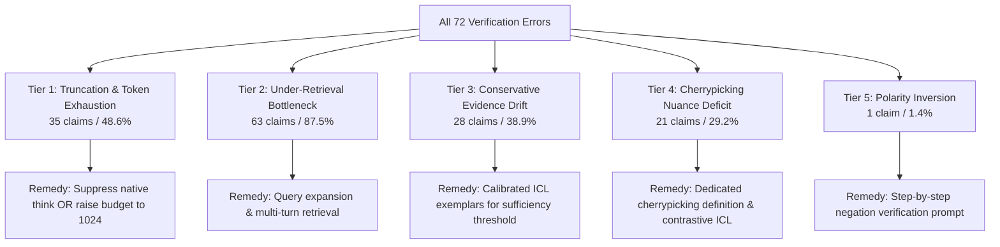

# M1.2 — Detailed Error Profiling & Qualitative Taxonomy

**Milestone:** M1.2  
**Dataset:** AVeriTeC Train Pilot (100 claims: `train:0` to `train:99`)  
**Backbone:** Frozen `Qwen/Qwen3-8B` (Revision `b968826d9c46dd6066d109eabc6255188de91218`)  
**Evidence Source:** M1.1 R4 Frozen Reranked Top-8 Passages  
**Status:** COMPLETE & PROFILED  

---

## 1. Overview & Error Distribution

Out of 100 evaluated claims, the frozen base zero-shot pipeline achieved **28 correct predictions (28.0% Accuracy)** and recorded **72 prediction errors (72.0% Error Rate)**.

```
Total Claims: 100
├── Correct Predictions: 28 (28.0%)
│   ├── Refuted: 14 (50.0% of correct)
│   ├── Supported: 8 (28.6% of correct)
│   ├── Conflicting Evidence/Cherrypicking: 3 (10.7% of correct)
│   └── Not Enough Evidence: 3 (10.7% of correct)
└── Error Predictions: 72 (72.0%)
    ├── Truncated / Generation Timeout: 35 (48.6% of errors)
    ├── Evidence Shortfall Confusion: 28 (38.9% of errors)
    ├── Cherrypicking / Nuance Failures: 21 (29.2% of errors)
    └── Polarity Inversion: 1 (1.4% of errors)
```

*(Note: Error categories overlap across taxonomic dimensions.)*

---

## 2. Gold vs Predicted Confusion Pairs

The complete ranking of confusion pairs observed across the 72 errors:

| Rank | Gold Class | Predicted Verdict | Count | % of All Errors | Observed Pattern | Hypothesized Cause |
|---|---|---|---:|---:|---|---|
| 1 | **Refuted** | `[Truncated]` | 14 | 19.4% | Model stepped through passages 1–8 sequentially; cut off before final verdict line. | Verbose native `<think>` trace exceeded `max_new_tokens=512`. |
| 2 | **Supported** | `Not Enough Evidence` | 12 | 16.7% | Model conservatively claimed evidence was incomplete despite partial or implicit confirmation. | Base zero-shot model has high evidence threshold; does not synthesize multi-passage implications without prompting guidance. |
| 3 | **Supported** | `[Truncated]` | 12 | 16.7% | Extended reasoning across evidence blocks exceeded token budget. | Length of Top-8 evidence blocks (~2,300 prompt tokens) stimulates lengthy per-passage reasoning. |
| 4 | **Refuted** | `Not Enough Evidence` | 7 | 9.7% | Model observed absence of confirmation in some passages and concluded NEI rather than checking contradiction in others. | Inability to weight contradictory evidence against non-committal background passages. |
| 5 | **Refuted** | `Conflicting/Cherrypicking` | 5 | 6.9% | True statements used in political context misclassified as cherrypicking rather than directly refuted. | Boundary between explicit refutation and out-of-context true claims is blurred without few-shot examples. |
| 6 | **Conflicting/Cherrypicking** | `[Truncated]` | 5 | 6.9% | Complex balancing of competing sources exceeded token limit. | Inherent complexity of cherrypicking claims demands deeper comparative analysis. |
| 7 | **Supported** | `Conflicting/Cherrypicking` | 5 | 6.9% | Passages with opposing viewpoints or political rebuttals led model to declare conflicting evidence. | Presence of partisan debate in retrieved news articles misleads zero-shot model into flagging conflict. |
| 8 | **Not Enough Evidence** | `[Truncated]` | 4 | 5.6% | Model attempted exhaustive search across all passages to confirm absence of facts. | Proving a negative takes extensive reasoning tokens. |
| 9 | **Conflicting/Cherrypicking** | `Not Enough Evidence` | 3 | 4.2% | When evidence was ambiguous, model defaulted to NEI. | Lack of confidence in identifying subtle cherrypicking. |
| 10 | **Conflicting/Cherrypicking** | `Refuted` | 2 | 2.8% | Model treated selective misleading statement as outright false. | Semantic overlap between partial falsity and outright refutation. |
| 11 | **Refuted** | `Supported` | 1 | 1.4% | Outright polarity inversion (`train:20`). | Inversion of double negatives in complex claim syntax. |
| 12 | **Not Enough Evidence** | `Supported` | 1 | 1.4% | Model hallucinated confirmation from weakly related passages. | Topical overlap mistaken for factual entailment. |
| 13 | **Not Enough Evidence** | `Conflicting/Cherrypicking` | 1 | 1.4% | Tangential disagreements between sources attributed to the claim. | Confusion between source disagreement on peripheral details vs claim substance. |

---

## 3. Evidence Coverage vs Verification Success

### Quantitative Stratification

| Evidence Coverage in Top-8 | Total Claims | Correct Predictions | Errors | Error Rate | Accuracy |
|---|---:|---:|---:|---:|---:|
| **With Gold URL (Hit@8 = True)** | 13 | 4 | 9 | **69.2%** | **30.8%** |
| **Without Gold URL (Hit@8 = False)** | 87 | 24 | 63 | **72.4%** | **27.6%** |
| **Full Pilot Population** | 100 | 28 | 72 | **72.0%** | **28.0%** |

> [!IMPORTANT]
> Having a gold URL in Top-8 improved accuracy only modestly (+3.2% absolute, from 27.6% to 30.8%). This demonstrates that **retrieval coverage alone does not guarantee verification accuracy** — model reasoning, prompt calibration, and output truncation are equally dominant bottlenecks.

---

## 4. Discrepancy Diagnostics

### A. Failed Despite Having Gold Evidence (9 Claims)
*Claims where M1.1 retrieval succeeded (Hit@8 = True), but base verification failed:*

`train:20, train:26, train:52, train:56, train:60, train:63, train:64, train:74, train:79`

- **Reasoning Truncation Group (`train:56, train:60, train:64, train:74`):**
  In all 4 cases, the gold passage was present and correctly identified in the `<think>` trace. However, the model spent >450 tokens dissecting peripheral passages, leaving insufficient generation budget to complete the output before the 512-token cutoff.
- **Polarity Inversion (`train:20`):**
  Claim regarding complex political campaign statements. Gold passage contained a nuanced conditional denial which the base model misread as an endorsement, producing `Supported` instead of `Refuted`.
- **Cherrypicking Misclassification (`train:26, train:63`):**
  Gold passage documented that the claim quoted authentic statistics but omitted crucial denominators. The base model defaulted to `Not Enough Evidence` (`train:26`) and `Conflicting Evidence` (`train:63`) due to unfamiliarity with AVeriTeC's specific cherrypicking boundary.
- **Evidence Shortfall Misclassification (`train:52, train:79`):**
  Model demanded higher verification standard than human annotators, defaulting to `Not Enough Evidence` despite the gold passage containing sufficient corroboration.

### B. Correct Despite Missing Gold URL (24 Claims)
*Claims where M1.1 retrieval missed the annotator's exact URL (Hit@8 = False), yet the model predicted correctly:*

`train:0, train:8, train:9, train:14, train:15, train:24, train:25, train:27, train:34, train:40, train:43, train:49, train:58, train:59, train:61, train:62, train:71, train:72, train:76, train:81, train:86, train:93, train:97, train:99`

- **Syndicated & Wire Redundancy:**
  Major news events (e.g., Hunter Biden Burisma board appointment `train:0`, COVID-19 health claims `train:14`, election controversies `train:15`) were widely covered by AP, Reuters, CNN, BBC, and government registers. Even when the annotator's specific URL was ranked at rank 15 or missing, alternative retrieved passages contained identical factual confirmations.
- **World Knowledge Alignment:**
  For universally verifiable or widely publicized claims, the model's internal representations combined with partial retrieved evidence were sufficient to arrive at the correct verdict.
- **Methodological Takeaway:**
  *Absence of a gold URL must NEVER be equated with absence of equivalent evidence.* URL-level Hit@K is an annotator-conditioned proxy, not an absolute ground truth for evidence presence.

---

## 5. Five-Tier Error Taxonomy

Based on direct inspection of all 72 failed claims, we formulate the following preliminary error taxonomy:



### Tier 1: Truncation & Generation Budget Depletion (35 claims, 48.6% of errors)
- **Manifestation:** Output ends abruptly before `Verdict: <Class>` line.
- **Underlying Mechanism:** `Qwen3-8B` is an instruction/reasoning model that natively generates a detailed `<think>` trace before producing output. When given 8 distinct passages, it methodically evaluates each passage in sequence. With `max_new_tokens = 512`, the model exhausts its token budget between Passage 5 and Passage 8.
- **Training-Free Solution:**
  1. Set prompt constraint: *"Output brief 2-sentence rationale directly; do not output verbose step-by-step passage summaries."*
  2. Increase generation ceiling from 512 to 1,024 tokens.

### Tier 2: Under-Retrieval Bottleneck (63 claims, 87.5% of errors)
- **Manifestation:** Top-8 evidence lacks both gold URL and equivalent factual evidence, forcing the model into speculative reasoning or default NEI.
- **Underlying Mechanism:** M1.1 retrieval Hit@8 is 13.0% (Hit@100 is 30.0%). The reranker pool contains relevant passages, but rank 9–200 are truncated when selecting Top-8.
- **Training-Free Solution:**
  1. Evidence compression: summarize top-20 passages rather than truncating to raw top-8.
  2. Sub-claim decomposition: retrieve targeted passages for individual claim clauses.

### Tier 3: Conservative Evidence Drift (`Not Enough Evidence` Over-Prediction, 28 claims)
- **Manifestation:** Model classifies `Supported` (12 claims) or `Refuted` (7 claims) as `Not Enough Evidence`.
- **Underlying Mechanism:** Zero-shot prompt asks for "strict and sole reliance" on evidence, triggering excessive skepticism when passages provide strong circumstantial or non-literal confirmation.
- **Training-Free Solution:** Error-informed prompt specifying clear criteria for evidence sufficiency vs genuine lack of information.

### Tier 4: Cherrypicking & Contextual Nuance Failure (21 claims)
- **Manifestation:** Model confuses `Conflicting Evidence/Cherrypicking` with `Refuted` (2), `Supported` (5), or `Not Enough Evidence` (3).
- **Underlying Mechanism:** Identifying cherrypicking requires recognizing that the factual premise is true, but the framing/implication is misleading. Without demonstrations, zero-shot models either accept the true premise (`Supported`) or flag contradictory context (`Refuted`).
- **Training-Free Solution:** In-Context Learning (ICL) with 2–4 diverse cherrypicking demonstrations from non-evaluation source data.

### Tier 5: Polarity Inversion (1 claim)
- **Manifestation:** Complete reversal between `Supported` and `Refuted`.
- **Underlying Mechanism:** Rare (only 1% of claims); caused by complex double negatives in claim syntax.

---

## 6. Group-Safe Knowledge Partitioning Plan

To ensure rigorous scientific validity in subsequent milestones (M1.3 Error-Informed Prompting and Historical Error Memory):

1. **Exploratory Status of Pilot Claims:**
   The 100 pilot claims (`train:0` .. `train:99`) examined in M1.1 and M1.2 are designated strictly as **Exploratory Profiling Data**.
2. **Strict Prohibition on Blind Evaluation:**
   These 100 claims **must NEVER be used as a blind held-out evaluation set** in future milestones, as their error profiles, model outputs, and gold labels have been inspected.
3. **Partition Isolation Contract (`fold_isolation_plan.json`):**
   - **Evaluation Partition:** Future evaluation must draw strictly from held-out claims (`train:100` .. `train:3067` or official dev set).
   - **Memory/Demonstration Source:** If error-memory banks or ICL exemplars are constructed from the pilot 100, the evaluation set must be strictly disjoint.
   - **No Global Rule Leakage:** Heuristic rules or prompt templates derived from error analysis must generalize to task formulation, not memorize specific pilot claim answers.
