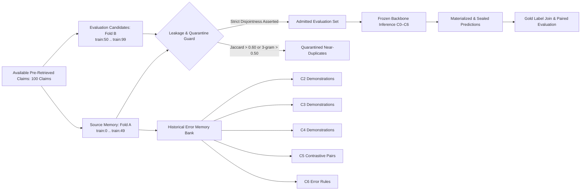

# M1.3 — Error-Informed Training-Free Fact Verification: Experimental Protocol & Architecture

**Milestone:** M1.3  
**Status:** IMPLEMENTED & READY FOR SERVER GPU EXECUTION  
**Target Hardware:** NVIDIA GeForce RTX 5090 (32 GB VRAM) on `hvtham-server`  
**Dataset Ground Truth:** AVeriTeC `train.json` (Four-class ontology)  
**Retrieval Evidence:** M1.1 R4 Frozen Reranked Top-8 Evidence Passages  
**Base Protocol:** Base Protocol v1.0 (B1 Non-Thinking Qwen3-8B, 512 max new tokens; Accuracy: 54.0%, Macro-F1: 0.4265)  
**Core Constraint:** STRICTLY TRAINING-FREE & QUALITY-FIRST. Zero model parameter updates, zero gradient backpropagation, zero fine-tuning, zero learned neural routers, zero selective routing optimization.

---

## 1. Research Question & Scientific Hypothesis

### Core Research Question
*Does structured historical error knowledge (empirical failure modes, corrected mistakes, contrastive pairs, and derived verification checklists) improve fact verification performance with a frozen LLM over neutral zero-shot base verification without modifying model parameters?*

### Theoretical Hypotheses
1. **Hypothesis 1 (Error Correction vs Correct Demonstrations — C4 vs C3):**
   Demonstrating *how* base models fail on subtle verification boundaries (e.g. mistaking reported political debate for factual evidence conflict) along with verified corrections will provide stronger calibration against recurrent traps than standard correct demonstrations alone.
2. **Hypothesis 2 (Contrastive Boundary Clarification — C5):**
   Explicitly contrasting a canonical correct case with a near-boundary error case will sharpen class boundaries on low-recall categories (`Conflicting Evidence/Cherrypicking` and `Not Enough Evidence`).
3. **Hypothesis 3 (Rule Distillation Efficiency — C6):**
   Distilling empirical failure modes into an explicit 4-point verification checklist will deliver reasoning gains without consuming context length or exemplar token budget.

---

## 2. Experimental Condition Matrix (C0–C6)

All conditions use the exact same frozen `Qwen/Qwen3-8B` backbone (revision `b968826d9c46dd6066d109eabc6255188de91218`), same decoding configuration (`enable_thinking=False`, `max_new_tokens=512`, `temperature=0.0`), and identical Top-8 evidence passages.

| Condition | Name | Knowledge Source | Prompt Composition | Context Budget |
|---|---|---|---|---|
| **C0** | Base Protocol v1.0 | None (Zero-shot) | Neutral prompt + Top-8 evidence + 4-class ontology | ~1,200 tokens |
| **C1** | Generic Task Instruction | Guidelines only | Enhanced general fact-checking instructions + Top-8 evidence | ~1,400 tokens |
| **C2** | Random Source ICL | $\mathcal{D}_{\text{source}}$ | 4 balanced exemplars (1 per class) randomly sampled from source | ~2,600 tokens |
| **C3** | Correct-Only ICL | $\mathcal{D}_{\text{correct}} \subset \mathcal{D}_{\text{source}}$ | 4 balanced exemplars (1 per class) where Base B1 was correct | ~2,600 tokens |
| **C4** | Error-Only ICL (with Gold Corrections) | $\mathcal{D}_{\text{error}} \subset \mathcal{D}_{\text{source}}$ | 4 error exemplars targeting top confusion pairs + baseline pitfall analysis + gold correction | ~2,800 tokens |
| **C5** | Contrastive Correct/Wrong ICL | $\mathcal{D}_{\text{contrast}} \subset \mathcal{D}_{\text{source}}$ | 2 contrastive pairs (4 exemplars): Canonical correct vs subtle error counterpart on Supported and Refuted boundaries | ~2,800 tokens |
| **C6** | Source-Derived Error Rules | Synthesized from $\mathcal{D}_{\text{error}}$ | 4-point empirical verification checklist (Media debate vs fact, Evidence sufficiency threshold, Cherrypicking precision, Polarity check) | ~1,500 tokens |

---

## 3. Partition Safety & Anti-Leakage Protocol

Strict data partitioning and leakage defense are enforced prior to running any inference:



### Strict Anti-Leakage Guarantees
1. **Fold Disjointness:** Source memory claims and evaluation claims must have zero intersection (`assert_fold_disjointness` raises `ValueError` if any ID overlaps).
2. **Near-Duplicate Quarantine:** Evaluation claims are audited against source memory for word-level Jaccard similarity ($\ge 0.60$) and 3-gram containment ($\ge 0.50$). Any near-duplicates are quarantined to prevent memorization artifacts.
3. **Run-Time Exemplar Guard:** During prompt construction, `run_condition_inference` dynamically asserts that no sampled exemplar ID equals the target evaluation claim ID.
4. **Gold Label Sealing:** No evaluation gold labels, justifications, or QA annotations are accessed during prompt creation or inference. Gold labels are loaded strictly after prediction files are written and sealed.

---

## 4. Statistical Evaluation & Comparison Framework

Each condition $C_k$ is evaluated independently against `train.json` ground truth and then compared in paired fashion against Baseline $C_0$:

### A. Primary Metrics
- **Accuracy:** $\frac{\sum \mathbb{I}(y_{\text{pred}} = y_{\text{gold}})}{N}$
- **Macro-F1:** Unweighted mean of F1 scores across the 4 official AVeriTeC classes.
- **Per-Class P/R/F1:** Detailed evaluation for `Supported`, `Refuted`, `Not Enough Evidence`, and `Conflicting Evidence/Cherrypicking`.
- **Confusion Matrix:** 4x4 matrix capturing inter-class shifts.

### B. Paired Statistical Tests against Baseline C0
- **Exact Two-Sided McNemar Test:** Evaluates discordant transitions ($b$ claims where C0 is correct but C_k is wrong; $c$ claims where C0 is wrong but C_k is correct) using exact binomial calculation ($p = 0.5$):
  $$p = 2 \cdot \sum_{i=0}^{\min(b, c)} \binom{b+c}{i} 0.5^{b+c}$$
- **Paired Bootstrap 95% Confidence Interval:** 10,000 bootstrap resamples on paired claim-level accuracy differences ($\Delta = y_{C_k} - y_{C_0}$).
- **Mutually Exclusive Transition Categories:** Full breakdown ensuring $\sum \text{Categories} \equiv N$.

### C. Cost, Latency & Token Profiling
- Mean prompt tokens (input context length)
- Mean generation tokens (output generation budget)
- Mean latency per claim (seconds)
- Relative compute overhead ratio compared to $C_0$

---

## 5. Execution Instructions for GPU Server `stackops@hvtham-server`

All code, tests, and runner scripts are committed and pushed to `lee-vtruong/training-free-fact-verification`.

To execute the complete M1.3 benchmark across C0 through C6 on `hvtham-server`:

```bash
# 1. Navigate to project root and sync latest code from main
cd ~/whale/training-free-fact-verification
git pull origin main

# 2. Activate virtual environment
source .venv/bin/activate
export HF_HOME=/home/stackops/whale/cache/huggingface

# 3. Verify local tests
pytest -v --basetemp=temp_pytest -p no:cacheprovider

# 4. Make runner executable and run full M1.3 benchmark
chmod +x scripts/run_m13_error_informed.sh
bash scripts/run_m13_error_informed.sh 2>&1 | tee outputs/m13_run.log
```
