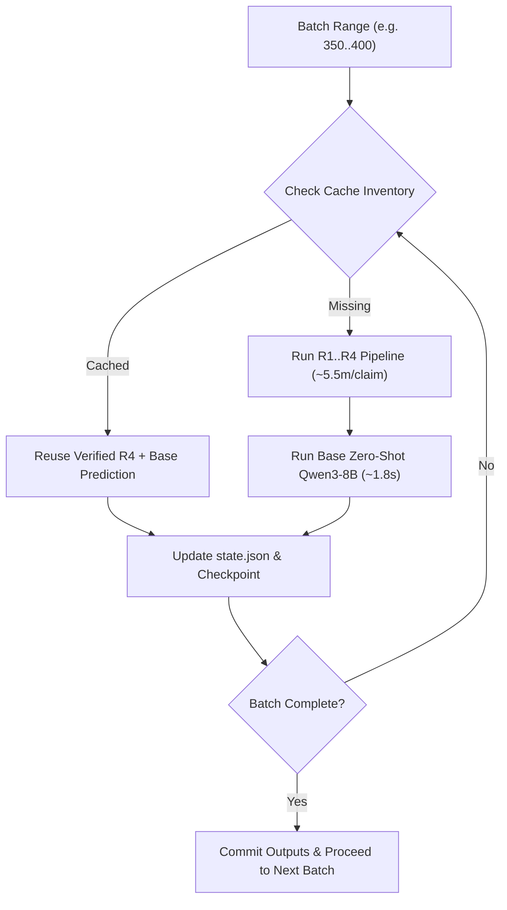

# M1.8a Resource, Runtime & Batch Execution Plan

This document establishes the resource consumption profile, empirical latency benchmarks, and unattended batch execution plan for constructing the Full-Train Historical Error Memory across all 3,068 AVeriTeC train claims.

---

## 1. Workload & Scope Breakdown

| Dataset Partition / Scope | Claims | Status | GPU Workload Required |
| :--- | :---: | :---: | :--- |
| **Official Train Total** | 3,068 | Full raw corpus | None (metadata audit) |
| **Valid Train Claims** | 3,067 | Text valid, 4-class ontology | Target population |
| **Invalid Train Claim** | 1 | `train:1948` (empty text `""`) | Quarantined / Excluded |
| **Train-Dev Text Overlaps** | 4 | Text identical to Dev claims | Quarantined / Logged |
| **Official Dev (Sealed)** | 500 | Final evaluation split | **STRICTLY UNREAD & EXCLUDED** |
| **Existing R4 Cache** | 449 | Top-8 evidence pre-computed | **Reused without re-computation** |
| **Existing Base Prediction Cache** | 414 | Base zero-shot pre-computed | **Reused without re-computation** |
| **Remaining Fresh R4 Retrieval** | 2,618 | Requires R1–R4 pipeline | ~240 GPU hours (~10 days) |
| **Remaining Fresh Base Inference**| 2,653 | Frozen Qwen3-8B BF16 | ~1.5 GPU hours |
| **Historical Error Candidates** | ~1,500 | Base accuracy ~50.72% | ~1.5 GPU hours (14B Judge) |

---

## 2. Empirical Benchmark Latencies (RTX 5090 32GB)

Empirical timing measurements on server `hvtham-server`:

### A. R1–R4 Retrieval Pipeline
- **BM25 Search (R1):** ~0.4s per claim
- **Qwen3-Embedding-0.6B Dense (R2):** ~3.2s per claim
- **RRF Reciprocal Rank Fusion (R3):** ~0.1s per claim
- **Qwen3-Reranker-0.6B Cross-Encoder (R4 Top-100 scoring):** ~5.0–5.5 minutes per claim (includes document scraping, text canonicalization, and neural reranking)
- **Total R4 Latency:** $\approx 5.5\text{ minutes/claim}$ ($\approx 10.9\text{ claims/hour}$).

### B. Frozen Base Zero-Shot Verifier (Qwen3-8B BF16)
- **Prompt Size:** ~2,500 tokens (Top-8 evidence passages + instructions).
- **Generation:** Greedy decoding, `enable_thinking=False`, `max_new_tokens=512`.
- **Latency:** $\approx 1.8\text{ seconds/claim}$ ($\approx 2,000\text{ claims/hour}$).

### C. Stronger Frozen LLM Judge (Qwen3-14B-AWQ)
- **Stage 1 (Gold-blind Evidence Assessment):** $\approx 1.8\text{ seconds/claim}$.
- **Stage 2 (Correction Validation against Gold):** $\approx 1.8\text{ seconds/claim}$.
- **Total Two-Stage Latency:** $\approx 3.6\text{ seconds/candidate}$ ($\approx 1,000\text{ candidates/hour}$).

---

## 3. Hardware & Memory Footprint

| Component | Precision / Format | Model Weights | VRAM Overhead | RTX 5090 Headroom (32GB) |
| :--- | :---: | :---: | :---: | :---: |
| **Qwen3-Embedding + Reranker** | FP16 | ~1.2 GB | ~2.5 GB | **29.5 GB free** |
| **Qwen3-8B Base Verifier** | BF16 | ~16.0 GB | ~17.5 GB | **14.5 GB free** |
| **Qwen3-14B-AWQ Judge** | AWQ 4-bit | ~9.8 GB | ~11.5 GB | **20.5 GB free** |

*Rule:* Models are loaded sequentially or in isolated services (e.g. Judge server on port 17171) to ensure zero OOM risk.

---

## 4. Phased Batch Execution Strategy

Because retrieving all 2,618 claims takes ~240 GPU hours, execution is structured into **idempotent batches of 50 to 100 claims**:

### Safety & Resilience Invariants:
1. **Zero Overwrite:** Completed claims in `state.json` and existing receipt directories are never re-executed.
2. **Fail-Closed State Tracking:** State is flushed to disk after every single claim.
3. **Quarantine Isolation:** `train:1948` (invalid) and cross-split dev duplicates are automatically skipped/flagged.
4. **Dev Leakage Zero-Tolerance:** Official dev (500 claims) gold and evidence remain strictly untouched.
